# Shahin — Logo Design

A logo design for a menswear brand, inspired by strength, elegance, and modern masculinity.

| | |
|---|---|
| **Project** | Logo Design |
| **Brand name** | Shahin (شاهين) |
| **Industry** | Menswear |

## Logo

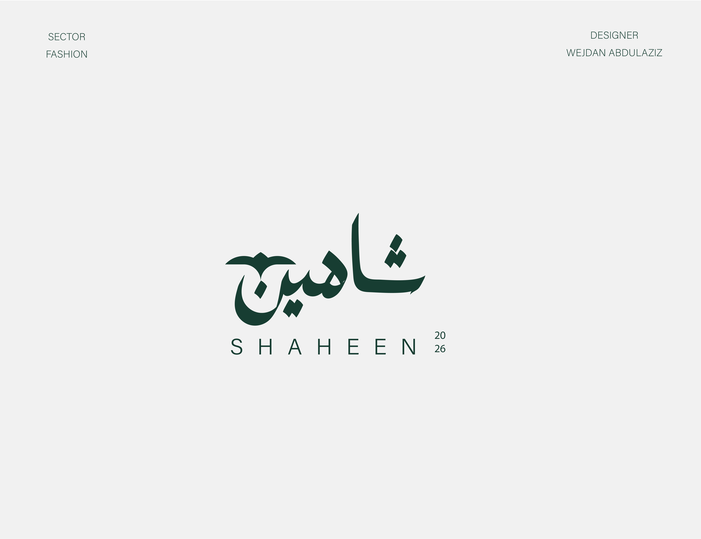 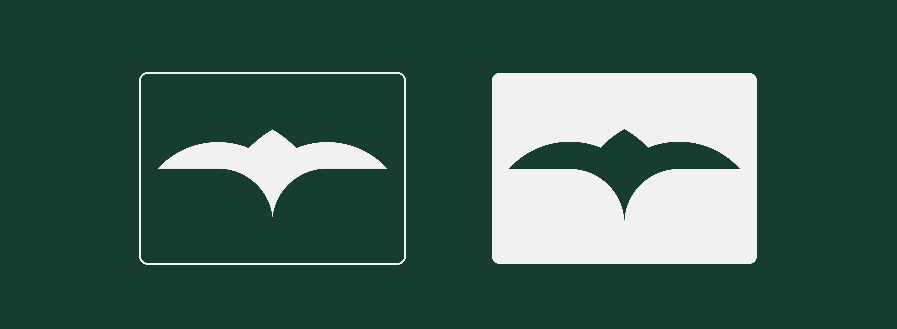 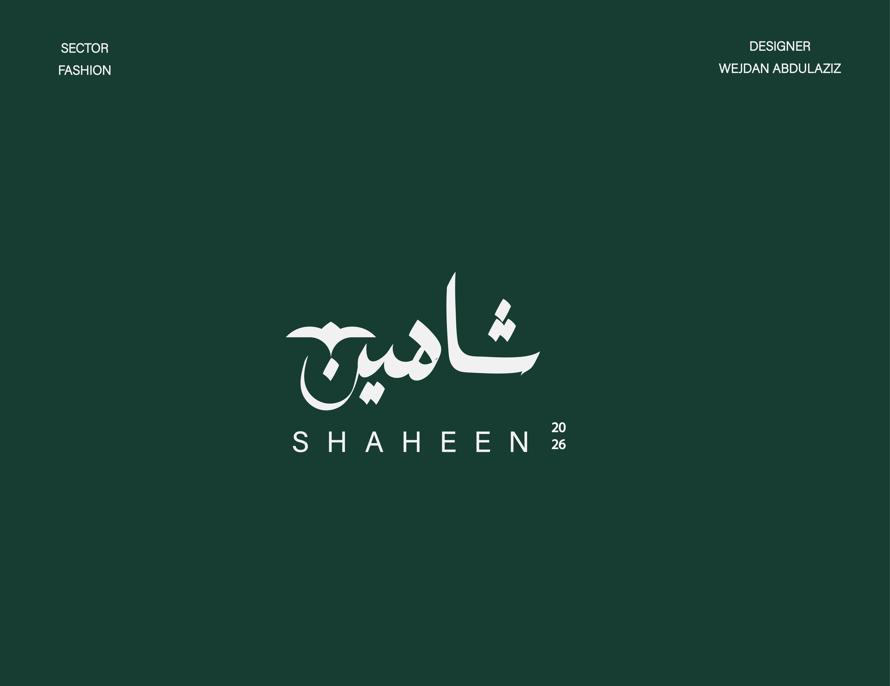

## Mockups

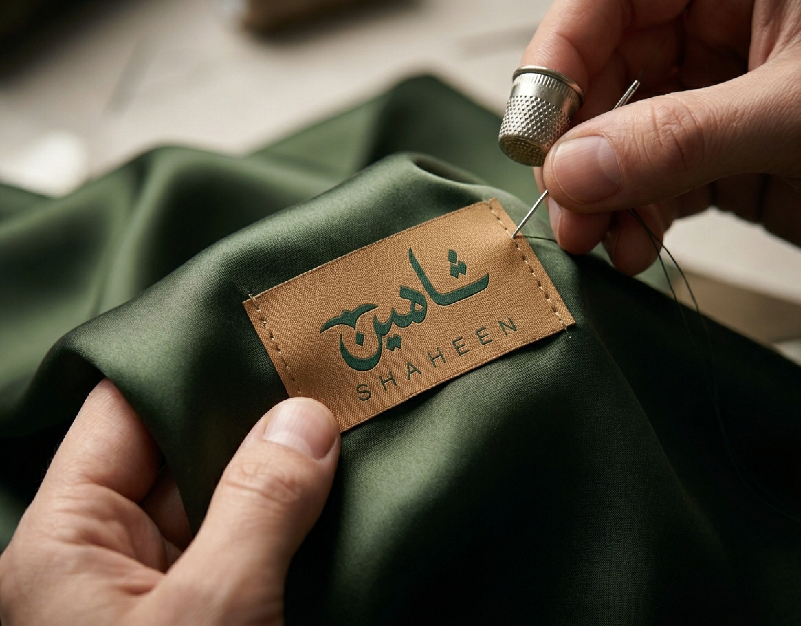 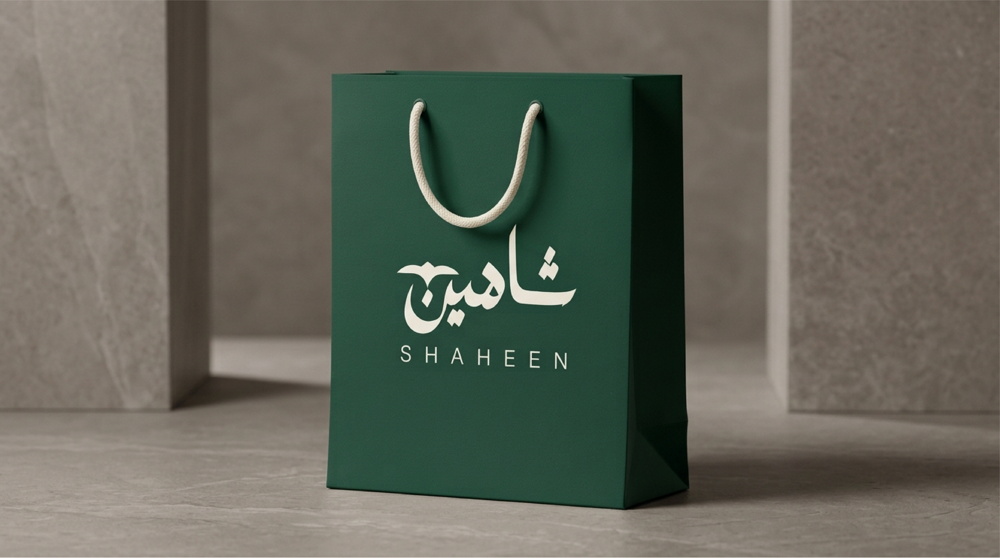 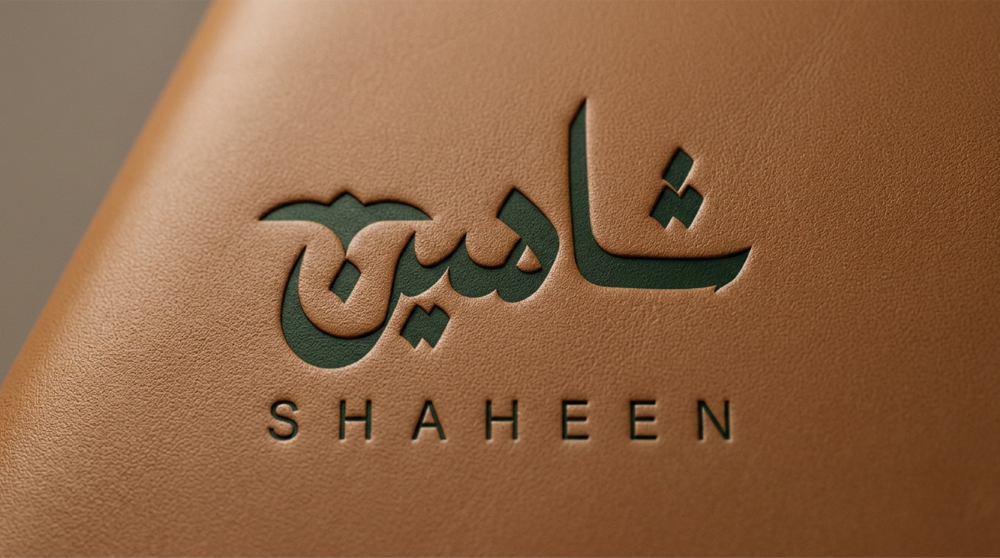
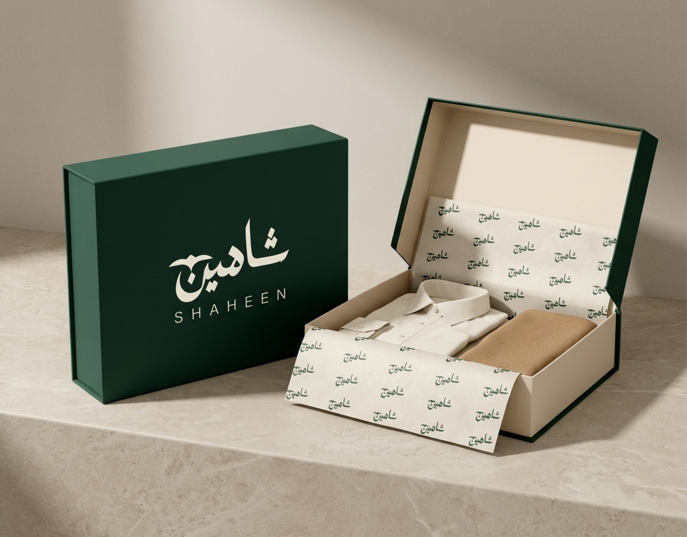 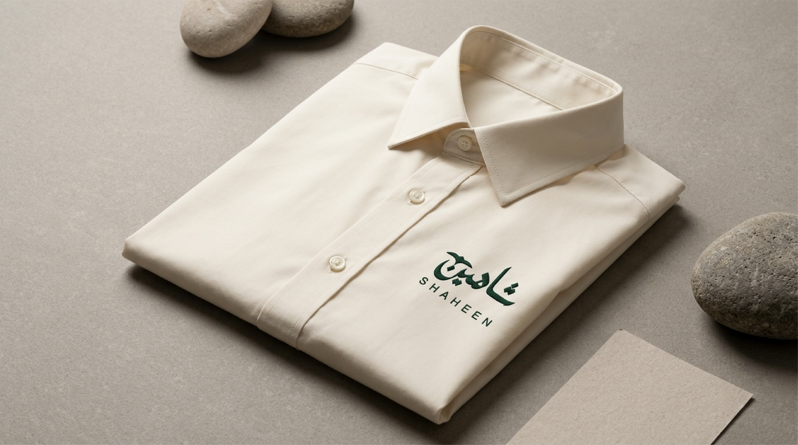 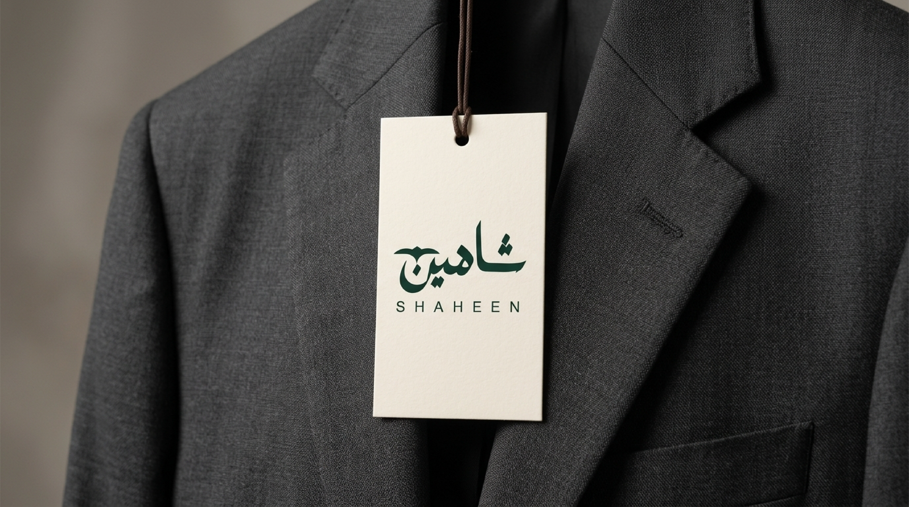
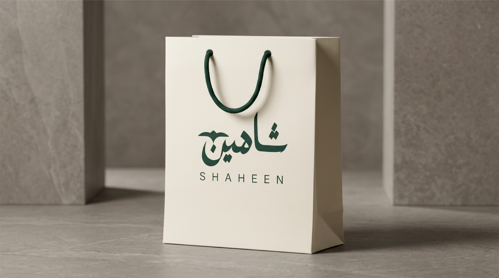 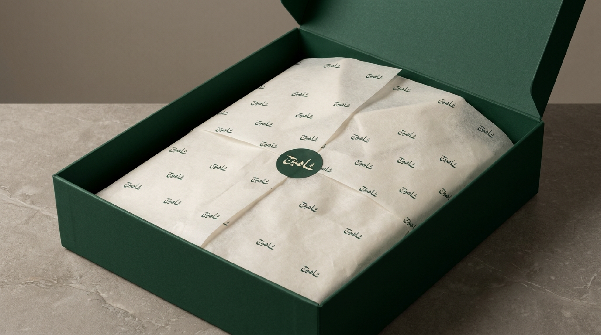 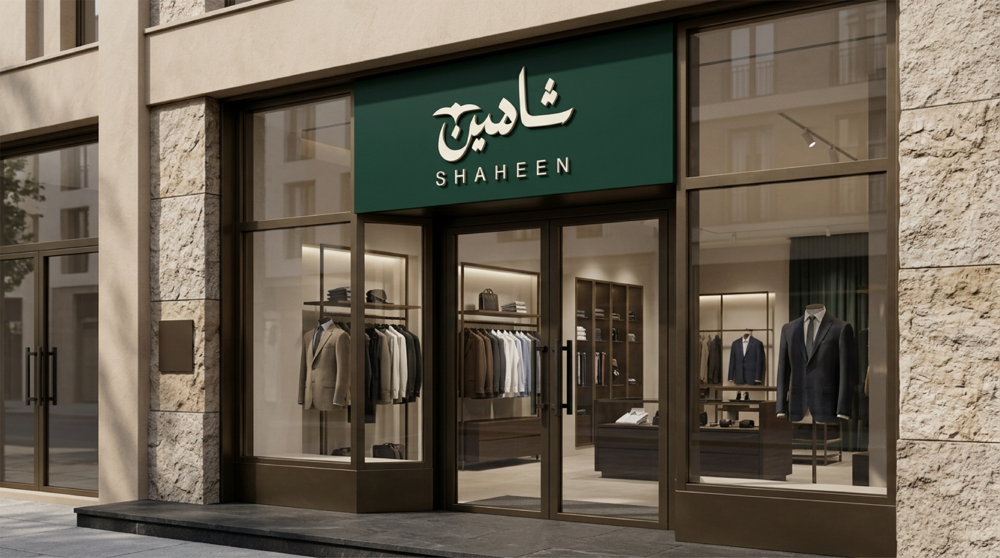

## More work

Behance: https://www.behance.net/wejdan_design_

© Wejdan Abdulaziz. All rights reserved.
